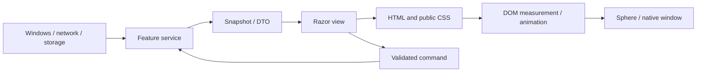

# Architecture and ownership

HIT is a Windows desktop host. Photino owns the native window; Blazor renders the interface inside WebView2.
There is no HTTP API server required for extension calls. The public SDK exposes in-process C# contracts.

## Repository map

| Directory/file | Responsibility |
| --- | --- |
| `Program.cs` | DI composition, extension startup, Photino configuration and shutdown |
| `Components/App.razor` | Theme manager, sphere and global extension drop target |
| `Components/DynamicSphere.razor` | Open/pin/close state, native geometry coordination and common header |
| `Components/HitMenuHost.razor` | Stable-ID component instances, navigation, settings routing and layout requests |
| `Components/HitMenus/` | Built-in entry components only |
| `Components/Audio`, `Clock`, `Extensions` | Feature views and subtelas; they do not create extra dots |
| `Services/HitMenus` | Catalog, navigator and built-in context contracts |
| `Services/Extensions` | Validation, installation, runtime, API adapters, asset provider and Inbox |
| `Services/Settings`, `Themes`, `Diagnostics` | Preferences, public CSS and memory sampling |
| `Services/Audio`, `Clock` | Native/media integrations and persistent deadline domain logic |
| `Services/DesktopWindowService.cs`, `Windows*` | Native window behavior, hit testing, drag, placement and tray |
| `Sdk/HIT.Sdk` | Independent public extension contracts |
| `Examples/HIT.Example` | SDK-only module, Notes layout, CSS, manifest and template |
| `wwwroot` | Public CSS/JS, HTML bootstrap, loading sphere and bundled themes |
| `Resources/en.json` | Embedded English source-message catalog |
| `Tools`, `Tests`, `Docs` | Authoring/validation tools, tests and all documentation |

## Data flow

Services own business state and external resources. Components coordinate views and commands.
JS owns DOM behavior, measurement and animation; CSS owns presentation. CSS does not persist a preference or execute a native command.

## Startup and shutdown

1. Create the Photino Blazor builder and register shared services, catalog, extension services and a composite file provider.
2. Build the host, load preferences and start the independent clock deadline service.
3. Finish pending package deletions and initialize enabled modules. Failed modules receive errors; built-ins remain available.
4. Refresh the catalog with built-in and loaded extension descriptors; start the optional Inbox import worker.
5. Configure the native transparent/chromeless window, attach native behavior and run Photino.
6. On exit, stop Inbox, cancel/stop module services, dispose module containers and request cooperative unloading.
   Unbind runtime settings and dispose clock/audio/lyrics services.

The startup loader awaits `IHitModule.StartAsync`. Authors must keep startup short and return after launching cancellable workers,
rather than awaiting an endless worker inside StartAsync.

## Menu identity and ownership

Built-in IDs are full CLR type names. External IDs are `{packageId}:{menuId}`.
The catalog exposes all manageable menus separately from enabled, loaded navigable menus.
The host stores visited instances, component references, titles and layouts by ID, preserving ownership after reorder.
Settings is always last. A new visit mounts a component; ordinary navigation hides it and preserves state.
Disabling/removing a menu unmounts its component. This is different from merely hiding it.

External components receive their own `IHitApi` and the shared UI context. Their private service container
does not expose the application's root DI container. Built-ins use root DI directly.
Read [Menus](MENUS.md), [Extensions](EXTENSIONS.md) and [API](API.md) before crossing these boundaries.

## Persistence and assets

Global preferences use normalized immutable records and atomic temporary-file replacement.
Clock state persists UTC deadlines so progress survives restart/sleep without accumulating display ticks.
Extension state has its own package directory, outside versioned binaries; package JSON keys are author-owned.

The file-provider composition serves `wwwroot` plus supported assets under `extensions/{id}/{version}/...`.
It does not expose extension DLLs as browser assets. Editable CSS is public; compiler outputs remain executable code.
The theme parser scopes imported global areas; the extension parser scopes package-local CSS to a menu ID.

## Threading, errors and resource budgets

Renderer state changes use `InvokeAsync`; native/media access remains in services with serialized access where needed.
Use cancellation, timeouts and explicit capability/generation checks, not synthetic keyboard shortcuts.
Errors belong to the affected view/operation. Extension render boundaries help with UI failures;
they do not contain arbitrary crashes or runaway trusted plugin code.

Pause view work when hidden, unsubscribe on disposal, bound caches and avoid resending images or CSS without changes.
The clock worker is deliberately independent of visibility. Audio global artwork metadata is another explicit exception.
Details and historical measurements: [Performance](PERFORMANCE.md).
